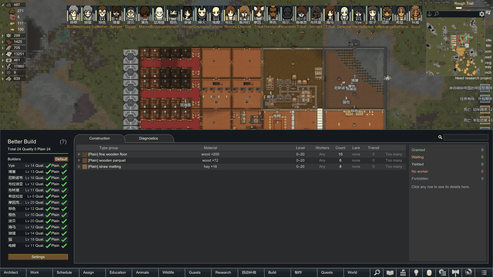
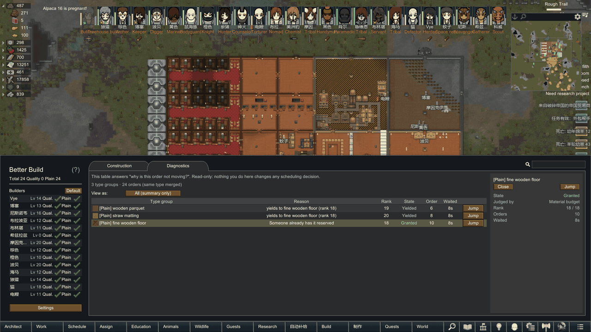
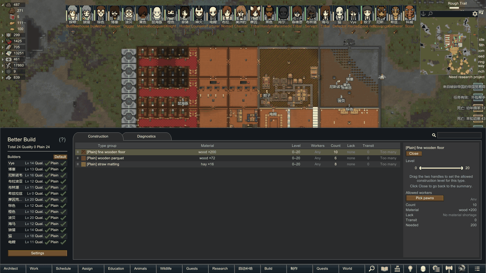

# Better Build

> A single panel for RimWorld's construction system: gate building by level range and a builder list, hand out materials by rank, and explain why an order isn't moving.

[简体中文](README.md) · RimWorld 1.7 · Requires Harmony · MIT

## What it does

Vanilla construction tells you whether a blueprint *can* be built and who is allowed to build. It does not tell you which order should go first, who is qualified, or which order is starving for materials.

This mod adds a panel on the construction side and makes those decisions explicit: per-type level ranges and builder lists, material allocation by rank, aging promotion for long-waiting orders, and a Diagnostics tab that states the reason an order is stuck.

## Features

- **Build permissions**: allow quality and/or plain construction per colonist, for automatic work.
- **Level range per type**: set a construction level interval with a two-handle range bar. Only colonists inside the interval *and* holding the matching permission will build automatically. `0~20` means no limit.
- **Outstanding orders**: blueprints and frames are merged by type, one row each, with one-click camera jump and a "too many" guard for large batches. Drag the `≡` handle to change build order; higher rows get materials reserved when stock is short, lower rows will not steal the same material, and orders that cannot proceed are skipped. Jump-to-location is supported.
- **Material budget and scheduling diagnostics**: materials are allocated by rank, long-waiting orders are promoted over time, borrowing opens after the protection period. The Diagnostics tab states, per order, one of five verdicts: granted, waiting for materials, yielding, nobody available, or building disabled.
- **Search**: a search box at the top right filters both tabs by name; the colonist lists in the left pane and the builder list can each be sorted (name by default, level ascending or descending), independently.
- **Row height**: adjust the type table row height in pixels from the scheduling dialog.
- **Quality build fix**: if QualityBuilder fails to re-place a blueprint after a quality-set building is deconstructed, this mod places it and carries the quality requirement over.
- **Roof-first deconstruction**: before deconstructing a load-bearing building that would collapse a roof, ordinary roofs are removed first; overhead mountain is refused, and roof markers are restored if the job is cancelled.

## Requirements

| Item | Value |
|---|---|
| Game version | RimWorld **1.7** |
| Required | **Harmony** (`brrainz.harmony`), from the Workshop or GitHub |
| Recommended | QualityBuilder (the quality build fix cooperates with it; not required) |
| Incompatible | None found. Tested in-game against an existing 211-mod list with no errors from this mod |

## Installation

**Steam Workshop**: subscribe after release, make sure Harmony and Better Build are both enabled, then restart the game.

**Manual**:

1. Put the `更好的建造` folder into `RimWorld\Mods\` (or the `Mods` folder inside your game directory) — **keep the Chinese folder name as is**
2. Launch the game, enable Harmony and Better Build in the Mods dialog
3. Apply and restart

## Quick start

1. Open the **Build** entry from the main bar; each building type takes one row.
2. Click the level hint on a row and drag the two-handle range bar to set the allowed construction level range.
3. To limit who may build, expand the builder list on the right and tick names; the status line shows `N listed · M can build`.
4. When an order is not moving, switch to **Diagnostics** and read the reason column: waiting for materials, yielded, or nobody available.

## Screenshots

| Construction | Diagnostics |
|---|---|
|  |  |

| Level range | Builder list |
|---|---|
|  |  |

> All screenshots are from a live game. The environment shown had 211 mods enabled, so UI elements from other mods may appear.

## Known limitations

See [Known issues](Docs/KNOWN_ISSUES.en.md). Three points:

- Detailed yield log lines stop after roughly 80 entries in one session (scheduling and UI are unaffected).
- Loading an old save with this mod disabled produces component errors and default settings; **re-enable to recover, and do not save while it is disabled**.
- The "yields to X (rank N)" reason is shown for a few seconds only, then falls back to the regular reason.

## More documentation

| What you want | Where |
|---|---|
| Details and boundaries of each feature | [Features](Docs/FEATURES.en.md) |
| Code structure, scheduling flow, patch points | [Architecture](Docs/ARCHITECTURE.en.md) |
| What was tested and what was not | [Testing](Docs/TESTING.en.md) |
| Known issues and workarounds | [Known issues](Docs/KNOWN_ISSUES.en.md) |
| Contributing and pull requests | [Contributing](Docs/CONTRIBUTING.en.md) |
| Building it yourself (two modes) | [Development](DEVELOPMENT.en.md) |
| Artifact checksums and reproduction notes | [Archive](ARCHIVE.md) |

## License and feedback

- License: [MIT](LICENSE), `Copyright (c) 2026 Cicada`
- Source: <https://github.com/Cicada-Old/BetterBuild>
- Issues: open an Issue with game version, log excerpt and reproduction steps. The log lives at `%USERPROFILE%\AppData\LocalLow\Ludeon Studios\RimWorld by Ludeon Studios\Player.log`
