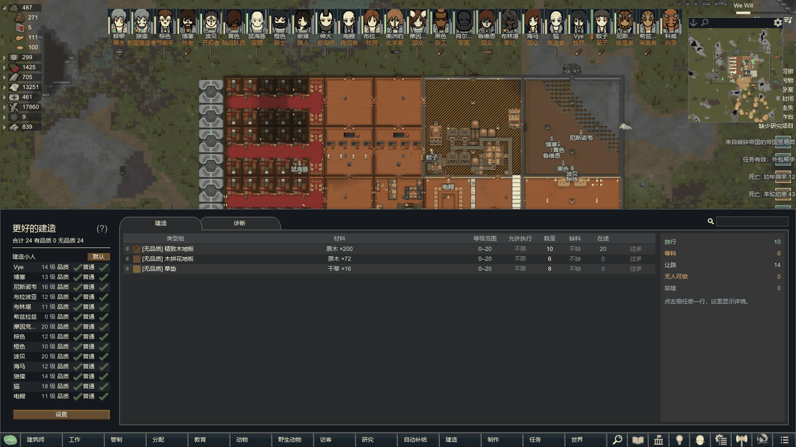
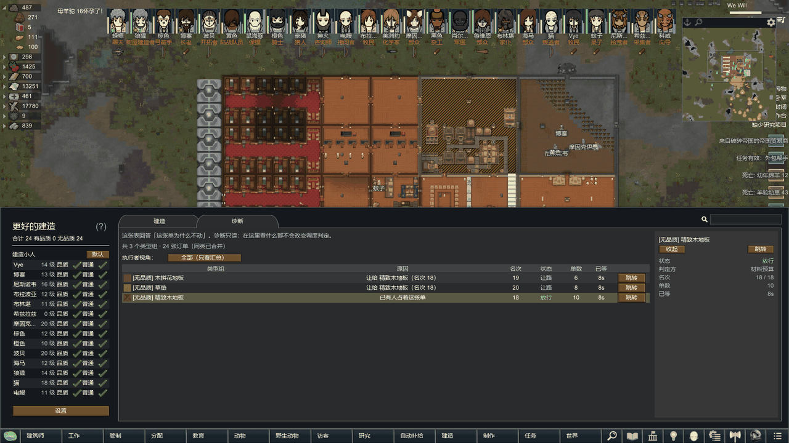
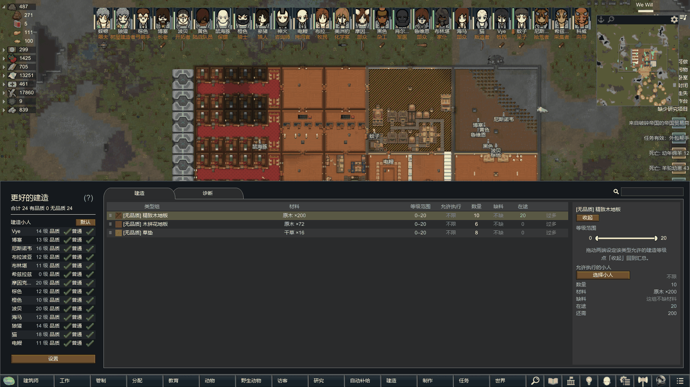
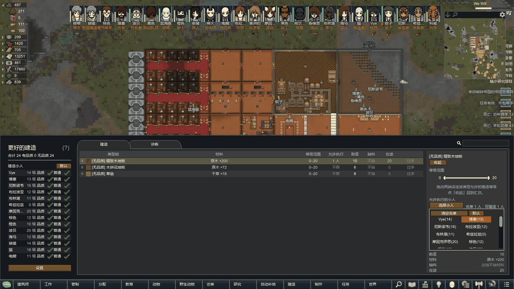

# 更好的建造（Better Build）

> 给 RimWorld 的建造系统加一层统一管理面板：按等级范围与名单放行、按名次分配材料、把「为什么不动」讲清楚。

[English](README.en.md) · RimWorld 1.7 · 需要 Harmony · MIT

## 这是什么

原版建造只有「能不能造」和「谁去造」，没有「该不该现在造、谁有资格造、材料先给谁」。订单多了以后，玩家看到的是小人到处跑、材料被低优先级订单抢走、某张单子永远不动却不知道原因。

本模组在建造侧加一个面板，把这些判断显式化：每种建造类型可以设等级范围和执行名单，材料按名次分配，久等的订单会提权，条件不满足的订单会在「诊断」页写明原因。

## 功能

- **建造权限**：按小人分别允许「有品质 / 无品质」建筑的自动建造。
- **建造等级范围**：每种建造类型可设定建造等级区间（双柄区间条）。只有区间内、且具备对应建造权限的小人才会自动建造。`0~20` 表示不限。
- **未建造统计**：按种类合并列出蓝图 / 框架数量，同类合并成一行；可一键跳转镜头，同类过多时提示先清一部分。拖动左侧 `≡` 调整顺序，建造按该顺序优先；高优先级缺料时会为它预留材料，低优先级不抢同类材料，条件不满足自动跳过。可一键跳转定位。
- **材料预算与调度诊断**：材料按名次分配、久等订单自动提权、到期开放借用。「诊断」页逐单给出五种结论之一：放行 / 等料 / 让路 / 无人可做 / 禁建。
- **搜索过滤**：窗口右上角的搜索框按名称过滤，建造页与诊断页同时生效；左栏与右区的小人列表各自可排序（默认按名字 / 建造等级升序 / 降序），两栏互不影响。
- **行高自定义**：在「调度设置」里按像素调整类型组表格的行高，适配不同分辨率与字号。
- **品质建造修复**：手动或自动拆除「已设品质」的建筑后，如果 QualityBuilder 没有重新放置蓝图，本模组兜底补放并继承品质要求。
- **拆前先拆屋顶**：拆除会塌屋顶的承重建筑前，先把普通屋顶清掉；厚岩顶直接拦下不拆，拆除任务取消后会撤销屋顶标记。

## 支持版本与依赖

| 项 | 值 |
|---|---|
| 游戏版本 | RimWorld **1.7** |
| 必需前置 | **Harmony**（`brrainz.harmony`），从创意工坊或 GitHub 安装 |
| 建议同时安装 | QualityBuilder（品质建造修复会与它配合，不装也能用） |
| 不兼容 | 未发现。与 211 个 mod 的现有组合实机跑过，无本模组报错 |

## 安装

**创意工坊**：发布后可从工坊页订阅，订阅后确认 Harmony 与本模组都已启用，重启游戏。

**手动安装**：

1. 把 `更好的建造` 文件夹放进 `RimWorld\Mods\`（或在 Steam 库中打开游戏目录下的 `Mods`）
2. 启动游戏，在「模组」界面启用 Harmony 与「更好的建造」
3. 应用并重启

## 快速上手

1. 打开主界面的「建造」入口，左侧是建造页：每种建造类型一行。
2. 点类型名右侧的等级提示，拖动双滑块设定允许的建造等级范围。
3. 需要限定具体小人时，展开右区名单勾选；状态行会显示「名单 N 人 · 可建造 M 人」。
4. 订单不动时，切到「诊断」页看原因列，它会写明是等料、让路还是没人能做。

## 截图

| 建造页 | 诊断页 |
|---|---|
|  |  |

| 等级范围 | 执行名单 |
|---|---|
|  |  |

> 以上均为实机画面。截图所在环境启用了 211 个模组，界面中可能包含其它模组的元素。

## 已知限制

完整清单见 [已知问题](Docs/KNOWN_ISSUES.md)。三条要点：

- 让路明细日志在同一局里累计约 80 条后不再输出（不影响调度与界面）。
- 停用本模组后打开旧存档会刷组件报错、设置显示默认值；**重新启用即可恢复，停用期间不要保存**。
- 诊断页「让给 X（名次 N）」只显示约几秒，之后恢复为常规原因。

## 更多文档

| 想看什么 | 去哪 |
|---|---|
| 每项功能的细节与边界 | [功能说明](Docs/FEATURES.md) |
| 代码结构、调度流程、补丁点 | [架构说明](Docs/ARCHITECTURE.md) |
| 做了哪些测试、哪些没覆盖 | [测试说明](Docs/TESTING.md) |
| 已知问题与规避 | [已知问题](Docs/KNOWN_ISSUES.md) |
| 参与开发、报 PR | [贡献指南](Docs/CONTRIBUTING.md) |
| 自己构建（两档） | [开发说明](DEVELOPMENT.md) |
| 产物校验与复现记录 | [技术归档](ARCHIVE.md) |

## 许可证与反馈

- 许可证：[MIT](LICENSE)，版权 `Copyright (c) 2026 Cicada`
- 源码：<https://github.com/Cicada-Old/BetterBuild>
- 问题反馈：在仓库提 Issue，附游戏版本、日志片段与复现步骤；日志在 `%USERPROFILE%\AppData\LocalLow\Ludeon Studios\RimWorld by Ludeon Studios\Player.log`
